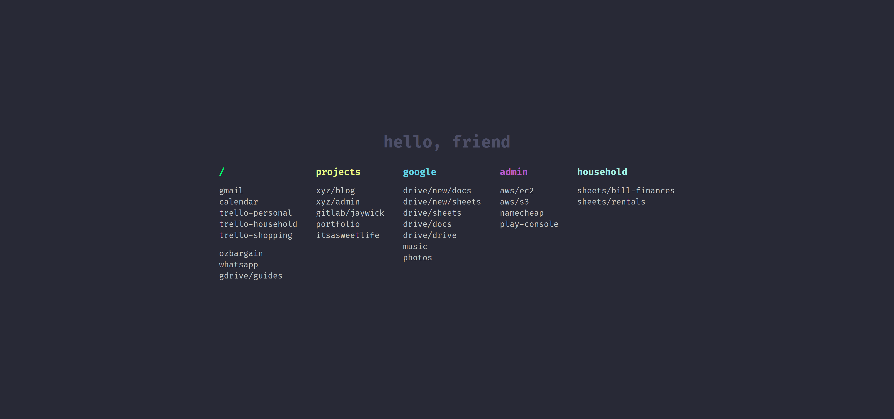

## Preview



## Releases

- Firefox: https://addons.mozilla.org/en-US/firefox/addon/hello-friend-new-tab/
- Chrome: https://chrome.google.com/webstore/detail/hello-friend/aehibelbdjcoffckialjmnilfimajain

## Notes

- This directory is the source of truth for the extension. The sibling folders named `Copy` and exported ZIP files are not development sources.
- Chrome and Firefox use the same Manifest V3 `manifest.json`.
- Remote favicon lookups are off by default. Enabling them requests optional access to Google and sends bookmark hostnames to Google. The Google Fonts stylesheet used by the UI is a separate existing network request.

## Roadmap / Contributions

See https://github.com/mdial009/hello-stitch/issues

## Local development

Clone the source

    git clone git@github.com:mdial009/hello-stitch.git

Firefox

1. Go to `about:debugging` in address bar
2. Click _Load Temporary Add-on_ button on top right
3. Select `manifest.json` in this directory.

Chrome

1. Go to `chrome://extensions/` in address bar
2. Tick _Developer mode_ toggle at top right
3. Click _Load Unpacked_
4. Choose this directory (the Chrome Manifest V3 source).


## Importing and exporting

The Data & Backup settings include a versioned bookmark-only backup and a full backup. Bookmark-only backups preserve folder paths and manual order. Full backups also include extension local data and settings; the selected browser folder is kept local to the current browser profile. Older JSON exports containing a plain list of columns remain importable.

Import always shows a preview before applying a merge. A matching URL in the same destination folder has its title updated; the same URL elsewhere is copied into the imported location so existing placements are preserved. If the merge fails partway through, the dialog reports that earlier changes may already have been saved.

Manual sorting follows the browser bookmark order and enables drag-and-drop. Other sort modes disable dragging so displayed positions cannot be confused with the saved bookmark order. If the usual bookmarks toolbar cannot be identified, the extension asks you to select an existing browser bookmark folder; it does not move or modify that folder's current contents.

## Tests

Run the utility, bookmark-import, and duplicate-URL reorder tests from this directory with Node:

```bash
node tests/utils.test.js
node tests/bookmark-import.test.js
node tests/bookmark-actions.test.js
node tests/render.test.js
```

The tests print a `... tests passed` message for each successful test file.
